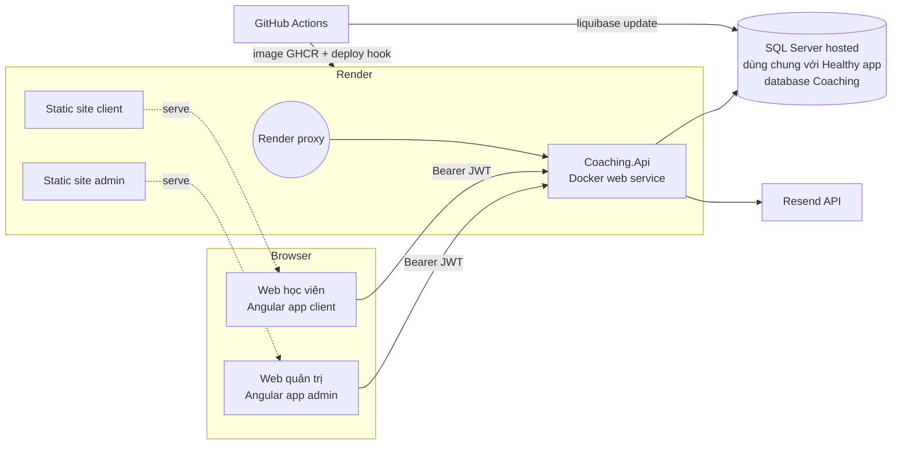

# Technical Design: F00 — Codebase BE + FE + CI/CD + môi trường test

## Meta

| Field | Value |
|-------|-------|
| Author | Hoangduc1203BK (soạn cùng Claude) |
| Date | 2026-11-24 |
| Spec | `docs/agentic-workflow/specs/2026-11-24-f00-codebase.md` |
| BDD | `@BR-f00-codebase-*`, `@NFR-f00-codebase-002`, `@NFR-f00-codebase-008` trong `features/nen-tang/**` |
| JIRA | N/A — local-only |

---

## 1. Tổng quan

### Vấn đề
Backend (commit `b34102e`) đã có Identity + JWT + 2 nhóm route, nhưng lệch spec ở 5 chỗ:
- rate limit theo IP proxy;
- thông báo khóa khác thông báo sai mật khẩu;
- không có ân hạn khi gia hạn trùng;
- thiếu seed vẫn chạy;
- chưa có học viên demo.

Thời gian JWT/lockout không giả lập được trong test. Chưa có frontend, CI, compose, Render.

### Goals
- Sửa backend cho khớp BR-f00-codebase-001 → 020.
- Workspace Angular 22 gồm 2 app + lib `shared`: đăng nhập, phiên, khung giao diện đúng prototype.
- Chạy tự động mọi scenario `@api`/`@integration`/`@web` và phép so ảnh NFR-f00-codebase-002.
- `docker compose up` chạy toàn hệ thống; GitHub Actions; deploy Render khi main xanh.

### Non-Goals
- Aggregate Student (làm ở F02). Học viên demo ở P0 chỉ là tài khoản đăng nhập vai trò Student.
- Health "readiness" có kiểm DB. Giữ `/health` là liveness (OQ-01 spec).
- Endpoint chỉnh đồng hồ cho E2E. Hai scenario thời gian là `@manual`.
- Hosting production, CD production, migration bundle.

---

## 2. Bối cảnh & Kiến trúc tổng quan

### Hiện trạng
- `backend/src/Coaching.Infrastructure/Identity/AuthService.cs:46-67`: refresh dùng lại token đã thu hồi thì `RevokeAllAsync` ngay, không phân biệt "đã đổi" hay "đăng xuất".
- `AuthService.cs:32-36`: lockout trả `AuthErrors.LockedOut`, câu chữ khác `InvalidCredentials`.
- `backend/src/Coaching.Api/Common/RateLimitPolicies.cs`: chia theo `Connection.RemoteIpAddress`; `Program.cs` không có `UseForwardedHeaders`.
- `backend/src/Coaching.Infrastructure/Seeding/DatabaseInitializer.cs`: thiếu AdminSeed chỉ `LogWarning` rồi `return`.
- `backend/src/Coaching.Api/Auth/AuthenticationSetup.cs`: JwtBearer kiểm hạn token bằng đồng hồ hệ thống.
- `TimeProvider` đã được đăng ký (`Infrastructure/DependencyInjection.cs`), `VietnamClock` dùng nó.
- `docs/duobexiuuu-coaching-design.html`: mở trang bằng `#<Page>&frame` (`&frame` ẩn menu prototype). Brand override `.rail` nền `#24121D` nằm ở `<style id="brand-style">`.

### Kiến trúc tổng quan



- Môi trường local và E2E: `deploy/docker-compose.yml` dựng `db` + `liquibase` (chạy changelog rồi thoát) + `api` + `web`. `web` là nginx phục vụ admin ở cổng 4200, client ở 4300, và proxy `/api` về `api:8080`, nên cùng origin, không cần CORS.
- Môi trường Render: 3 origin khác nhau, nên cần CORS 2 origin.

---

## 3. Giải pháp đề xuất

### Quyết định kiến trúc

- `ADR-f00-codebase-001` — Kiểm vai trò ngay ở API đăng nhập
  - **Quyết định**: `POST /api/auth/login` nhận thêm `app: "admin" | "client"`. Nếu vai trò không khớp, trả 403 `auth.wrong_app` và **không cấp token**.
  - **Lý do**: BR-f00-codebase-004/005 yêu cầu phiên sai vai trò không tồn tại. Không cấp ngay từ đầu thì đơn giản và an toàn hơn để FE cấp rồi gọi logout.
  - **Trade-off chấp nhận**: lộ việc email/mật khẩu đúng nhưng sai web. Chấp nhận được vì người gọi đã biết đúng mật khẩu.
- `ADR-f00-codebase-002` — Lưu phiên ở SPA
  - **Quyết định**:
    - Access token chỉ giữ trong bộ nhớ (signal). Refresh token lưu trong `localStorage`, key theo app (`dbx.admin.rt` / `dbx.client.rt`).
    - Gia hạn dùng chung một luồng (single-flight) trong tab, khóa giữa các tab bằng `navigator.locks.request('dbx-refresh-<app>')`. Sau khi lấy được khóa, đọc lại `localStorage` trước khi gọi API.
    - Đăng xuất phát tin qua `BroadcastChannel('dbx-auth-<app>')`.
  - **Lý do**: `onrender.com` là public suffix nên cookie httpOnly dùng chéo site không khả thi. Access token trong bộ nhớ giảm thiệt hại khi bị XSS. BR-f00-codebase-010/014 cần giữ phiên khi mở lại trình duyệt và đồng bộ giữa các tab.
  - **Trade-off chấp nhận**: refresh token đọc được bằng JS (XSS). Giảm thiểu bằng xoay vòng token, phát hiện tái sử dụng (ADR-f00-codebase-003) và không dùng `innerHTML` từ dữ liệu.
- `ADR-f00-codebase-003` — Ân hạn 30 giây khi gia hạn trùng
  - **Quyết định**:
    - Thêm `RefreshToken.RevokedReason` (`Rotated` | `Logout` | `ReuseDetected`).
    - Token `Rotated` bị gửi lại trong ≤ 30s kể từ `RevokedAt`: cấp cặp token mới, không thu hồi gì.
    - Token `Rotated` bị gửi lại sau 30s: thu hồi mọi phiên (`ReuseDetected`).
    - Token `Logout`: chỉ trả 401.
  - **Lý do**: hiện thực BR-f00-codebase-011/012/013. Server chỉ lưu hash nên không trả lại được đúng token đã cấp, phải cấp cặp mới.
  - **Trade-off chấp nhận**: trong 30s, một token cũ có thể sinh thêm một nhánh phiên hợp lệ. Cửa sổ ngắn, nên chấp nhận.
- `ADR-f00-codebase-004` — IP thật sau proxy
  - **Quyết định**: `UseForwardedHeaders` (XForwardedFor | XForwardedProto), `ForwardLimit = 1`, xóa `KnownNetworks`/`KnownProxies`, đặt trước rate limiter. Lỗi 429 trả ProblemDetails tiếng Việt kèm header `Retry-After`.
  - **Lý do**: Render và nginx compose đều nối IP client vào cuối `X-Forwarded-For`. Chỉ lấy hop cuối thì client không giả được IP. Render không công bố dải IP proxy.
  - **Trade-off chấp nhận**: nếu API bị gọi thẳng không qua proxy thì client tự đặt được XFF. Render không mở cổng API ra ngoài proxy, nên chấp nhận.
  - **Hệ quả/ghi chú** (final review I1): chưa xác nhận được Render nối IP client vào cuối XFF hay chỉ thêm IP proxy của nó. Mặc định giữ nguyên (`ForwardLimit = 1`, đúng với nginx compose). Ở bước nghiệm thu trên Render, ghi lại `RemoteIpAddress` và XFF thô từ hai mạng client khác nhau để xác nhận header thật, rồi chỉnh bằng cấu hình `ForwardedHeaders__ForwardLimit` / `ForwardedHeaders__KnownProxies__N` / `ForwardedHeaders__KnownNetworks__N` (không cần sửa code). Có integration test `RateLimitProxyTests` chứng minh entry đầu giả mạo không chọn được bucket khi dùng cấu hình mặc định.
- `ADR-f00-codebase-005` — Thời gian giả lập được
  - **Quyết định**:
    - Mọi phép so thời gian dùng `TimeProvider` của DI.
    - JWT: `TokenValidationParameters.LifetimeValidator` so `expires` với `TimeProvider.GetUtcNow()`.
    - Lockout: `AuthService` tự kiểm `user.LockoutEnd` so với `IClock.UtcNow` thay vì `IsLockedOutAsync`.
    - Acceptance test thay `TimeProvider` bằng `FakeTimeProvider`.
  - **Lý do**: các scenario `@api` của BR-f00-codebase-003/007/012 cần tua thời gian (phút 14/16, khóa 5 phút, 30/45 giây). Tự kiểm `LockoutEnd` không phụ thuộc việc Identity có đọc `TimeProvider` hay không.
  - **Trade-off chấp nhận**: có thêm một ít code tự kiểm thay vì dùng thẳng API của Identity.
- `ADR-f00-codebase-006` — Địa chỉ API là cấu hình lúc chạy
  - **Quyết định**: mỗi app tải `/config.json` (`{ "apiBaseUrl": "..." }`) qua `provideAppInitializer` trước khi bootstrap.
    - Compose: `apiBaseUrl: ""` (cùng origin).
    - Render: build command ghi file này từ env `API_BASE_URL`.
  - **Lý do**: một bản build dùng cho mọi môi trường, không phải hard-code URL Render vào code.
  - **Trade-off chấp nhận**: thêm 1 request lúc khởi động app (~vài ms, file tĩnh).
- `ADR-f00-codebase-007` — Lib `shared` dùng thẳng source
  - **Quyết định**: `tsconfig.json` paths `"@coaching/shared": ["projects/shared/src/public-api.ts"]`. Không build `dist/shared`.
  - **Lý do**: lib không publish ra ngoài. Hiện thực NFR-f00-codebase-007 (chạy dev ngay, không build lib trước).
  - **Trade-off chấp nhận**: không có ranh giới package cứng. Kỷ luật import chỉ qua `public-api.ts`.
- `ADR-f00-codebase-008` — Hai runner acceptance theo tag
  - **Quyết định**:
    - Scenario `@api`/`@integration` chạy bằng **Reqnroll.xUnit** trong `backend/tests/Coaching.Acceptance`, link file `.feature` từ `features/**`, lọc `Category!=web&Category!=manual`.
    - Scenario `@web` chạy bằng **CucumberJS + Playwright** trong `frontend/e2e`, `--tags "@web and not @manual"`.
  - **Lý do**: phía .NET tái dùng được WebApplicationFactory + Testcontainers + FakeTimeProvider + đổi cấu hình seed theo từng scenario. Phía browser cần Playwright.
  - **Trade-off chấp nhận**: 2 bộ step definition, 2 ngôn ngữ. Ranh giới theo tag rõ ràng nên chấp nhận.
- `ADR-f00-codebase-009` — So ảnh với prototype ngay trong cùng lượt chạy
  - **Quyết định**:
    - Mỗi dòng Outline NFR-f00-codebase-002 mở prototype `file://…/docs/duobexiuuu-coaching-design.html#<Page>&frame` và app thật, cùng viewport.
    - Chụp cùng một vùng, tô kín các vùng mask trên cả 2 ảnh, so bằng `pixelmatch` (`threshold 0.1`). Đạt khi số pixel khác ≤ 2%.
  - **Lý do**: cùng máy, cùng font nên loại được sai lệch render giữa các máy. Không cần commit ảnh baseline.
  - **Trade-off chấp nhận**: phụ thuộc Google Fonts lúc chạy (cả 2 ảnh cùng phụ thuộc). Prototype đổi thì test đổi theo, đó là điều mong muốn.
- `ADR-f00-codebase-010` — Deploy Render bằng Blueprint
  - **Quyết định**: `render.yaml` ở root gồm:
    - `coaching-api`: runtime docker, `healthCheckPath: /health`, `autoDeployTrigger: checksPass`, `ASPNETCORE_ENVIRONMENT=Staging`, `PORT=8080`, `Jwt__SigningKey` dùng `generateValue: true`, các secret còn lại `sync: false`.
    - 2 static site: build `ng build <app>`, ghi `config.json` từ `API_BASE_URL`, route rewrite `/* → /index.html`.
    - Migrate + seed chạy lúc khởi động (như hiện có).
  - **Lý do**: hạ tầng nằm trong repo, review được. `checksPass` đảm bảo NFR-f00-codebase-005/006.
  - **Trade-off chấp nhận**: migrate lúc khởi động không an toàn khi chạy nhiều instance. Staging chỉ 1 instance; production sẽ có ADR mới.
- `ADR-f00-codebase-011` — Liquibase quản lý toàn bộ schema (thay phần "migrate lúc khởi động" của ADR-f00-codebase-010)
  - **Quyết định**:
    - Schema chỉ thay đổi qua Liquibase **4.33.0** (image `liquibase/liquibase:4.33.0`, có sẵn driver SQL Server). EF Core chỉ còn là ORM: xóa `Persistence/Migrations` và bảng `__EFMigrationsHistory`; API **không** migrate, chỉ seed dữ liệu (`Database:SeedOnStartup`).
    - Thư mục `database/` ở gốc repo, chia theo **version phát hành**:
      ```
      database/
        liquibase.properties.example
        changelog/
          db.changelog-master.xml          ← include lần lượt changelog của từng version
          v0.1.0/                          ← P0 (F00); P1 = v0.2.0, …
            changelog.xml                  ← include các changeset XML của version, theo thứ tự
            0001-initial-schema.xml        ← <changeSet> trỏ <sqlFile> script + <rollback><sqlFile> rollback
            0002-refresh-token-revoked-reason.xml
            scripts/0001-initial-schema.sql
            scripts/0002-refresh-token-revoked-reason.sql
            rollback/0001-initial-schema.rollback.sql
            rollback/0002-refresh-token-revoked-reason.rollback.sql
      ```
    - Mỗi changeset XML: `id` = tên file (vd `v0.1.0-0002-refresh-token-revoked-reason`), `author` = email người viết, `<sqlFile path="scripts/…" relativeToChangelogFile="true" splitStatements="true" endDelimiter="GO"/>`, `<rollback><sqlFile path="rollback/…" relativeToChangelogFile="true"/></rollback>`. Mỗi version gắn `<tagDatabase tag="v0.1.0"/>` ở cuối `changelog.xml` để rollback theo version.
    - `0001-initial-schema.sql` sinh một lần từ `dotnet ef migrations script 0 InitialCreate` của schema hiện có (bỏ dòng ghi `__EFMigrationsHistory`).
    - Nơi chạy:
      - **CI/CD**: job `db-migrate` (GitHub Actions, chỉ trên `main`, sau khi backend/frontend/e2e xanh) chạy `liquibase update` vào DB môi trường test, thông tin kết nối ở GitHub Secrets (`LIQUIBASE_URL`, `LIQUIBASE_USERNAME`, `LIQUIBASE_PASSWORD`). Render `autoDeployTrigger: checksPass` chờ cả job này.
      - **docker compose**: service `liquibase` chạy `update` rồi thoát; `api` `depends_on: liquibase: service_completed_successfully`.
      - **Test tự động** (IntegrationTests + Acceptance): `BeforeTestRun` chạy container Liquibase vào một database mẫu trên cùng SQL Server Testcontainers (chung network), backup database mẫu; mỗi scenario `RESTORE` thành database mới.
  - **Lý do**: user yêu cầu schema được quản lý theo version bằng Liquibase, với SQL thuần review được và rollback rõ ràng; tách migrate khỏi lúc API khởi động thì nhiều instance an toàn. Backup/restore database mẫu giữ mỗi scenario độc lập mà không phải chạy Liquibase hàng chục lần.
  - **Trade-off chấp nhận**: đổi model EF phải tự viết changeset tương ứng (không còn `dotnet ef migrations add`); test khởi động chậm hơn vài giây cho lần chạy Liquibase đầu.
- `ADR-f00-codebase-012` — CI/CD Render theo mẫu Healthy app (thay `checksPass` + Render tự build của ADR-f00-codebase-010, và tên secret của ADR-f00-codebase-011)
  - **Quyết định**:
    - `coaching-api` trên Render đổi sang `runtime: image` (`ghcr.io/ducky120301/coaching-web-api:latest`), `autoDeployTrigger: off`. Job `publish` (chỉ push `main`, sau backend/frontend/e2e) build `backend/Dockerfile`, đẩy GHCR 2 tag `<sha>` và `latest`.
    - 2 static site giữ nguyên build trên Render nhưng `autoDeployTrigger: off`.
    - Job `deploy-staging` (environment `staging`, `needs: [publish, db-migrate]`, concurrency không hủy): gọi `RENDER_DEPLOY_HOOK_API` kèm `&imgURL=<image sha>`, smoke test `GET <vars.STAGING_API_URL>/health` (bỏ qua có cảnh báo nếu chưa đặt biến), rồi gọi `RENDER_DEPLOY_HOOK_ADMIN` và `RENDER_DEPLOY_HOOK_CLIENT`.
    - Job `db-migrate` dùng secret của environment `staging` giống Healthy: `DB_JDBC_URL`, `DB_USERNAME`, `DB_PASSWORD`; chạy `validate` → `update-sql` (in SQL) → `update` → `history`, secret chỉ đặt ở step chạy Liquibase.
    - DB staging: database `Coaching` riêng trên SQL Server hosted đang dùng cho Healthy app (tài khoản admin của server). Changelog không tạo login nên không cần context lọc như Healthy.
    - Local/dev vẫn dùng SQL Server 2022 trong `deploy/docker-compose.yml`.
  - **Lý do**: PO đã có pipeline chạy ổn với Render ở Healthy app; Render chỉ chạy image đã qua test (đúng NFR-f00-codebase-005/006) và không build lại, nên deploy nhanh và đúng bản đã kiểm.
  - **Trade-off chấp nhận**: thêm 3 secret deploy hook và biến `STAGING_API_URL` phải cấu hình tay; package GHCR phải public hoặc khai báo Registry Credentials trên Render. Dùng chung server DB với Healthy nên hai dự án ảnh hưởng tài nguyên của nhau ở môi trường test.

### Component Design

**Backend**

| Component | File Path | Trách nhiệm | Lý do đặt ở đây | Dependencies |
|-----------|-----------|-------------|-----------------|--------------|
| AuthService | `backend/src/Coaching.Infrastructure/Identity/AuthService.cs` | Login kèm `app` + kiểm role (ADR-001), lỗi chung (BR-006), lockout theo `IClock` (ADR-005), grace/ReuseDetected/Logout (ADR-003) | Đã là adapter Identity | UserManager, AppDbContext, IClock |
| AuthErrors | `backend/src/Coaching.Application/Auth/AuthErrors.cs` | `InvalidCredentials` mang câu chữ BR-006; bỏ `LockedOut`; thêm `WrongApp(app)` 403 | Lỗi nghiệp vụ thuộc Application | — |
| LoginRequest | `backend/src/Coaching.Application/Auth/AuthModels.cs` | Thêm `ClientApp App` (enum `Admin`/`Client`) | Contract Application | — |
| RefreshToken | `backend/src/Coaching.Infrastructure/Identity/RefreshToken.cs` | Thêm `RevokedReason` | Entity hạ tầng auth | — |
| DatabaseInitializer | `backend/src/Coaching.Infrastructure/Seeding/DatabaseInitializer.cs` | Bỏ `MigrateAsync` (ADR-011); schema chưa có (thiếu bảng `DATABASECHANGELOG`) thì throw với thông báo chạy Liquibase; thiếu AdminSeed thì throw (BR-017); seed DemoStudent khi `DemoSeed:Enabled` (BR-020), idempotent | Đã là nơi seed | UserManager, RoleManager |
| Liquibase changelog | `database/changelog/**` | Nguồn duy nhất của schema, chia theo version (ADR-011) | Ngoài backend để CI/compose/test dùng chung | image `liquibase/liquibase:4.33.0` |
| DatabaseFixture (test) | `backend/tests/Coaching.TestSupport/DatabaseFixture.cs` | SQL Server Testcontainers + chạy Liquibase vào DB mẫu + backup; `NewDatabaseAsync()` restore DB mới | Dùng chung cho IntegrationTests và Acceptance | Testcontainers, Microsoft.Data.SqlClient |
| DemoSeedOptions | `backend/src/Coaching.Infrastructure/Seeding/DemoSeedOptions.cs` | `Enabled` (mặc định false), `Email`, `Password`, `FullName` | Cạnh AdminSeedOptions | — |
| AuthenticationSetup | `backend/src/Coaching.Api/Auth/AuthenticationSetup.cs` | `LifetimeValidator` theo `TimeProvider` (ADR-005) | Cấu hình JwtBearer ở Api | TimeProvider |
| RateLimitPolicies | `backend/src/Coaching.Api/Common/RateLimitPolicies.cs` | `OnRejected` → ProblemDetails tiếng Việt + `Retry-After` | Đã có | — |
| Program | `backend/src/Coaching.Api/Program.cs` | `UseForwardedHeaders` trước `UseRateLimiter` (ADR-004) | Pipeline | — |
| Acceptance tests | `backend/tests/Coaching.Acceptance/**` | Reqnroll step defs cho `@api`/`@integration` | ADR-008 | Mvc.Testing, Testcontainers.MsSql, Reqnroll.xUnit, Microsoft.Extensions.TimeProvider.Testing |

**Frontend** (`frontend/`)

| Component | File Path | Trách nhiệm | Lý do đặt ở đây | Dependencies |
|-----------|-----------|-------------|-----------------|--------------|
| Design tokens | `projects/shared/src/styles/_tokens.scss`, `_brand.scss`, `_base.scss` | CSS variables trong `CLAUDE.md` + override rail tối + focus/link/placeholder | Dùng chung 2 app | — |
| App config | `projects/shared/src/lib/config/app-config.ts` | `APP_CONFIG` token + `loadAppConfig()` đọc `/config.json` (ADR-006) | Dùng chung | HttpClient (fetch) |
| AuthService | `projects/shared/src/lib/auth/auth.service.ts` | `login(email,pw)`, `logout()`, `refresh()`, `user` signal, khôi phục phiên lúc khởi động | Dùng chung, nhận `CLIENT_APP` token | TokenStore, RefreshCoordinator |
| TokenStore | `projects/shared/src/lib/auth/token-store.ts` | Access trong bộ nhớ; refresh trong `localStorage` key theo app (ADR-002) | Tách để test | — |
| RefreshCoordinator | `projects/shared/src/lib/auth/refresh-coordinator.ts` | Single-flight + Web Locks + BroadcastChannel đăng xuất (BR-010, BR-014) | Phần khó nhất của auth, tách riêng để unit test | navigator.locks, BroadcastChannel |
| authInterceptor | `projects/shared/src/lib/auth/auth.interceptor.ts` | Gắn Bearer cho request tới `apiBaseUrl`; gặp 401 thì refresh 1 lần rồi gửi lại; refresh fail thì đưa về `/login` | Dùng chung | AuthService |
| authGuard + returnUrl | `projects/shared/src/lib/auth/auth.guard.ts`, `return-url.ts` | Chưa đăng nhập thì sang `/login?returnUrl=`; chỉ nhận path bắt đầu `/`, không phải `//`, không có `://` (BR-015) | Dùng chung | Router |
| LoginPage | `projects/shared/src/lib/login/login-page.component.*` | Màn `Main` trạng thái đăng nhập; map lỗi 401/403/429 sang câu chữ tiếng Việt | Dùng chung, cấu hình theo app | AuthService |
| UserMenu | `projects/shared/src/lib/ui/user-menu.component.*` | Khối avatar + tên + vai trò; bấm vào mở menu có "Đăng xuất" | Dùng ở cả 2 shell | AuthService |
| Icons | `projects/shared/src/lib/ui/icons.ts` | SVG path từ prototype (Hôm nay, …) | Tránh lặp SVG | — |
| AdminShell / AdminHome | `projects/admin/src/app/shell/*`, `home/*` | Rail + main `max-width 1160px`; home gọi `GET /api/admin/profile` | App admin | shared |
| ClientShell / ClientHome | `projects/client/src/app/shell/*`, `home/*` | Rail ≥ 880px / tab bar < 880px (CSS media query); home lời chào | App client | shared |
| Web image | `frontend/Dockerfile`, `frontend/nginx/default.conf` | Build 2 app; nginx 2 server block (4200/4300), SPA fallback, proxy `/api` | Ảnh chạy compose | — |
| E2E | `frontend/e2e/**` | CucumberJS + Playwright cho `@web`, so ảnh (ADR-009) | Cạnh code FE | @cucumber/cucumber, playwright, pixelmatch, pngjs |

**Hạ tầng**: `database/**` (Liquibase), `deploy/docker-compose.yml`, `deploy/.env.example`, `render.yaml`, `.github/workflows/ci.yml`, `frontend/.nvmrc` (`26`).

### API Contracts

```
POST /api/auth/login        body { email, password, app: "admin" | "client" }
  200 AuthTokens { accessToken, accessTokenExpiresAt, refreshToken, refreshTokenExpiresAt, user { id, email, fullName, roles[] } }
  401 ProblemDetails { code: "auth.invalid_credentials", title: <câu chữ BR-f00-codebase-006> }   // sai mk / không có email / đang khóa
  403 ProblemDetails { code: "auth.wrong_app", title: "Tài khoản này không có quyền vào khu vực coach." | "...khu vực học viên." }
  429 ProblemDetails { code: "rate_limited", title: "Bạn thao tác quá nhanh. Vui lòng thử lại sau {n} giây." } + header Retry-After: {n}
POST /api/auth/refresh      body { refreshToken }   200 AuthTokens | 401 auth.invalid_refresh_token | 429
POST /api/auth/logout       body { refreshToken }   204
GET  /api/admin/profile     (AdminOnly)   200 { id, displayName, email }
GET  /api/client/me         (StudentOnly) 200 { userId, email, fullName }
GET  /health                200 { status: "ok" }   // liveness, không kiểm DB
```

`app` bắt buộc. Thiếu hoặc sai giá trị trả 400. Thay đổi này phá tương thích với code cũ, nhưng chưa có client nào dùng API (xem §8 Backward Compatibility).

### Data Model / Database Changes

```sql
-- database/changelog/v0.1.0/scripts/0002-refresh-token-revoked-reason.sql
ALTER TABLE RefreshTokens ADD RevokedReason nvarchar(20) NULL;  -- 'Rotated' | 'Logout' | 'ReuseDetected'
-- database/changelog/v0.1.0/rollback/0002-refresh-token-revoked-reason.rollback.sql
ALTER TABLE RefreshTokens DROP COLUMN RevokedReason;
```
Lý do: ADR-f00-codebase-003 cần phân biệt token bị thu hồi do xoay vòng hay do đăng xuất. Lưu dạng chuỗi (EF `HasConversion<string>()`) để đọc DB dễ hiểu. Không cần index mới, vì truy vấn vẫn theo `TokenHash` (đã unique).

### Data Flow — gia hạn phiên giữa nhiều tab

```mermaid
sequenceDiagram
  participant T1 as Tab 1
  participant T2 as Tab 2
  participant L as Web Locks (dbx-refresh-admin)
  participant API
  T1->>API: GET /api/admin/profile (access hết hạn)
  API-->>T1: 401
  T2->>API: request khác → 401
  T1->>L: request lock
  T2->>L: request lock (chờ)
  L-->>T1: granted
  T1->>API: POST /auth/refresh (RT1)
  API-->>T1: 200 (AT2, RT2) ; RT1 → Rotated
  T1->>T1: lưu RT2 vào localStorage, gửi lại request gốc
  L-->>T2: granted
  T2->>T2: đọc localStorage: RT2 ≠ RT1 đã giữ → dùng RT2, không gọi refresh trùng
  Note over T2,API: Nếu T2 vẫn gửi RT1 trong ≤30s (mạng chậm) → API cấp cặp mới (ADR-003)
```

### Thiết kế giao diện (UI)

**Design link**: `docs/duobexiuuu-coaching-design.html` (prototype HTML, đã đọc). Mở trang qua `#Main&frame`, `#Admin-Dashboard&frame`, `#HvHomNay&frame`.

**Design system & platform**: web. Token, font, kích thước lấy đúng theo `CLAUDE.md` (mục Frontend), dùng CSS tự viết, không dùng thư viện UI. Icon SVG copy từ prototype.

**Màn hình**:
- **Đăng nhập** (cả 2 app) — người dùng đăng nhập bằng email + mật khẩu.
  - Bố cục theo `Main`: khối cover `--coverBg` bo 14px, padding `40px 48px`, chữ ký Yellowtail xoay −6°, headline Barlow 800 `line-height .84` uppercase; form h1 48px, input cao 52px bo 14px, nút cao 54px Barlow 700 22px.
  - Không có "Quên mật khẩu?" và trạng thái kích hoạt (F01).
  - Lỗi hiển thị bằng khối giống khối thông báo của prototype, nền `--warnBg`, chữ `--warn`, bo 12px, padding 16px.
- **Khung web quản trị** — coach thấy khu vực coach.
  - Rail theo `Admin-Dashboard`: `flex 1 1 220px; min 220; max 260`, nền tối theo brand, logo 34px + "Khu vực coach" 13px.
  - P0 chỉ có mục "Trang chủ" (style mục nav 15px/600, padding `11px 12px`, bo 12px).
  - Cuối rail là UserMenu: avatar 36px nền `--primary` + tên + "Quản trị viên"; bấm vào mở menu "Đăng xuất".
  - Main `flex 999 1 560px; padding 32px clamp(16px,3vw,48px) 48px`.
- **Trang chủ quản trị** — coach thấy lời chào.
  - Dòng ngày (14px `--muted`, định dạng "Thứ Hai, 23/11/2026") + h1 48px "Xin chào, {tên coach}" + email.
- **Khung web học viên** — học viên thấy khu vực học viên.
  - ≥ 880px: rail `flex 0 0 240px; padding 28px 16px; gap 28px`, mục nav "Hôm nay" (padding 12px, 15px, gap 12px), cuối là UserMenu.
  - < 880px: tab bar sticky dưới đáy, `grid` theo số mục, mỗi tab 12px. Gồm tab "Hôm nay" và tab avatar mở cùng UserMenu.
  - Main `max-width 1160px`, padding `40px 48px 56px` (rộng) / `16px 20px 24px` (hẹp).
- **Trang chủ học viên** — học viên thấy lời chào.
  - Dòng ngày + h1 Barlow 800 54px (rộng) / 38px (hẹp) "Chào {tên}" + dòng "Giáo án sẽ hiển thị ở đây khi coach phát hành."

**Vùng mask khi so ảnh (ADR-009)**:

| Màn | Vùng so | Vùng tô kín (mask) |
|---|---|---|
| Đăng nhập | toàn trang | nút "Quên mật khẩu?"; giá trị input (test điền đúng giá trị như prototype nên thường không cần mask) |
| Khung quản trị | phần tử `aside.rail` | danh sách nav; khối tên người dùng |
| Khung học viên, rộng | phần tử `aside.rail` | danh sách nav; khối tên người dùng |
| Khung học viên, hẹp | thanh tab | các mục tab |

Main của cả 2 khung không đưa vào phép so, vì P0 chưa có nội dung giống prototype.

---

## 4. Các phương án đã cân nhắc

- **Phương án đề xuất**: Bearer + refresh trong localStorage có khóa giữa tab, ân hạn 30s ở server, 2 runner acceptance theo tag, so ảnh trực tiếp với prototype. Vì sao thắng: chạy được trên tên miền mặc định của Render, phủ đủ các BR về phiên, và test được tua thời gian.
- **Đã loại — cookie httpOnly + rewrite `/api` qua static site**: Render static site chỉ rewrite/redirect, không reverse proxy tới origin khác một cách tin cậy cho mọi method. Cookie `SameSite=None` lại bị Safari ITP chặn. Loại vì không chắc chạy được trên môi trường test đã chốt.
- **Đã loại — FE tự kiểm vai trò sau khi nhận token rồi gọi logout**: tạo ra một phiên thừa trong khoảnh khắc, và phụ thuộc FE gọi logout thành công. ADR-001 làm ở server đơn giản hơn.
- **Đã loại — Playwright `toHaveScreenshot` với baseline commit sẵn**: baseline chụp trên Windows và Linux khác nhau do render font, sẽ phải cập nhật thủ công mỗi khi prototype đổi.
- **Đã loại — chỉ dùng CucumberJS cho mọi tag**: không tua được `TimeProvider` của server và không đổi được cấu hình seed theo từng scenario nếu chỉ gọi HTTP.

---

## 5. Implementation Map

| Create/Modify | File Path | Thay đổi gì | BR/ADR |
|---------------|-----------|-------------|--------|
| Modify | `backend/Directory.Build.props` | `WarningsNotAsErrors` NU1901–NU1904 | NFR-f00-codebase-005 |
| Modify | `backend/Directory.Packages.props` | + Reqnroll.xUnit, Microsoft.Extensions.TimeProvider.Testing | ADR-f00-codebase-008 |
| Modify | `backend/src/Coaching.Application/Auth/AuthModels.cs` | `LoginRequest.App` (`ClientApp`) | ADR-f00-codebase-001 |
| Modify | `backend/src/Coaching.Application/Auth/AuthErrors.cs` | câu chữ BR-006; `WrongApp`; bỏ `LockedOut` | BR-f00-codebase-004/005/006 |
| Modify | `backend/src/Coaching.Infrastructure/Identity/AuthService.cs` | kiểm role, lockout theo `IClock`, grace 30s, RevokedReason | BR-f00-codebase-004..007, 011..013; ADR-001/003/005 |
| Modify | `backend/src/Coaching.Infrastructure/Identity/RefreshToken.cs` + `Persistence/Configurations/RefreshTokenConfiguration.cs` | `RevokedReason` | ADR-f00-codebase-003 |
| Create | `database/changelog/v0.1.0/0002-refresh-token-revoked-reason.xml` + `scripts/…sql` + `rollback/…sql` | changeset thêm cột | ADR-f00-codebase-003 |
| Modify | `backend/src/Coaching.Infrastructure/Seeding/DatabaseInitializer.cs` | bỏ migrate, kiểm schema đã có; throw khi thiếu seed; seed demo | BR-f00-codebase-016..020; ADR-011 |
| Create | `database/` (master + `v0.1.0/` + `0001-initial-schema` từ EF InitialCreate), `liquibase.properties.example` | schema theo version | ADR-f00-codebase-011 |
| Delete | `backend/src/Coaching.Infrastructure/Persistence/Migrations/**` | EF chỉ còn là ORM | ADR-f00-codebase-011 |
| Create | `backend/tests/Coaching.TestSupport/**` | DatabaseFixture dùng Liquibase + backup/restore | ADR-f00-codebase-011 |
| Create | `backend/src/Coaching.Infrastructure/Seeding/DemoSeedOptions.cs` | options | BR-f00-codebase-020 |
| Modify | `backend/src/Coaching.Infrastructure/DependencyInjection.cs` | đăng ký DemoSeedOptions | BR-f00-codebase-020 |
| Modify | `backend/src/Coaching.Api/Auth/AuthenticationSetup.cs` | LifetimeValidator theo TimeProvider | BR-f00-codebase-003; ADR-005 |
| Modify | `backend/src/Coaching.Api/Common/RateLimitPolicies.cs` | OnRejected ProblemDetails + Retry-After | BR-f00-codebase-008 |
| Modify | `backend/src/Coaching.Api/Program.cs` | UseForwardedHeaders | BR-f00-codebase-008; ADR-004 |
| Modify | `backend/src/Coaching.Api/appsettings*.json` | `DemoSeed`, Cors cho compose | BR-f00-codebase-020 |
| Modify | `backend/tests/Coaching.Api.IntegrationTests/*` | login gửi `app`; test cũ về LockedOut sửa theo BR-006 | — |
| Create | `backend/tests/Coaching.Acceptance/**` | csproj link `features/**/*.feature`, `ApiHooks` (Testcontainers + FakeTimeProvider + config theo scenario), step defs | BR-f00-codebase-001..003, 006..008, 010..013, 016..020 |
| Create | `frontend/` (workspace Angular 22: `admin`, `client`, `shared`) | như Component Design | BR-f00-codebase-004/005, 010, 013..015; ADR-002/006/007 |
| Create | `frontend/e2e/**` | cucumber config, world, steps `@web`, `visual.ts` (pixelmatch) | BR-f00-codebase-004/005/010/013/014/015; NFR-f00-codebase-002; ADR-009 |
| Create | `frontend/Dockerfile`, `frontend/nginx/default.conf`, `frontend/.nvmrc` | ảnh web | NFR-f00-codebase-007 |
| Create | `deploy/docker-compose.yml`, `deploy/.env.example` | db + liquibase + api + web | NFR-f00-codebase-007 |
| Create | `render.yaml` | Blueprint | NFR-f00-codebase-006; ADR-010 |
| Create | `.github/workflows/ci.yml` | jobs backend / frontend / e2e / db-migrate (main) | NFR-f00-codebase-005; ADR-011 |
| Modify | `CLAUDE.md` | `Coaching.sln` → `Coaching.slnx`; lệnh chạy e2e/acceptance | — |

**Build order thô**:
1. Chuyển schema sang Liquibase (`database/` + DatabaseFixture cho test), rồi backend sửa theo BR kèm changeset và Acceptance (Reqnroll), xanh.
2. Workspace FE: tokens → auth core (TokenStore, RefreshCoordinator, interceptor, guard) → LoginPage → 2 shell + home.
3. Dockerfile web + compose.
4. E2E `@web` + so ảnh chạy trên compose.
5. CI.
6. `render.yaml` + deploy (cần chuỗi kết nối DB từ PO).

Lý do: backend là nền cho mọi test khác. Phải có compose thì E2E mới chạy được. Render làm cuối vì phụ thuộc hạ tầng bên ngoài.

---

## 6. Test Strategy

### Acceptance / E2E
Đã chốt ở `features/nen-tang/**` (tag `@BR-f00-codebase-*`, `@NFR-f00-codebase-002`, `@NFR-f00-codebase-008`). Runner theo ADR-f00-codebase-008. `@manual` (2 scenario thời gian của BR-010, NFR-008) kiểm tay.

### Unit / Integration
- **Backend:**
  - Domain/Application test hiện có giữ nguyên.
  - Thêm unit test `AuthService` cho bảng quyết định refresh (Rotated ≤30s / >30s / Logout / ReuseDetected).
  - Thêm unit test bộ kiểm tra seed (thiếu email/mật khẩu).
- **Frontend (Vitest):**
  - `RefreshCoordinator`: single-flight, đọc lại sau khi lấy lock, nhận tin đăng xuất. Đây cũng là nơi test ví dụ đã LOẠI "nhiều thao tác cùng lúc chỉ gia hạn 1 lần".
  - `returnUrl` sanitizer.
  - `authInterceptor`: 401 → refresh → retry đúng 1 lần.
  - `LoginPage`: map mã lỗi sang câu chữ.

### Automated verification
```bash
dotnet test backend/Coaching.slnx --filter "Category!=web&Category!=manual"
cd frontend && npm ci && npx ng build admin && npx ng build client && npx ng test --watch=false
docker compose -f deploy/docker-compose.yml --env-file deploy/.env.example up -d --build --wait
cd frontend && npx playwright install chromium && npm run e2e      # cucumber --tags "@web and not @manual"
```

### Manual verification
- 2 scenario `@manual` của BR-f00-codebase-010.
- NFR-f00-codebase-008 trên URL Render.
- Xem bằng mắt 390px / 1280px trên Chrome và Safari iOS.

---

## 7. Risks & Mitigations

| Risk | Impact | Likelihood | Mitigation |
|------|--------|------------|------------|
| Reqnroll không sinh code-behind cho `.feature` link từ ngoài project | Medium | Medium | Task đầu tiên của acceptance là spike 1 scenario. Nếu fail thì copy feature vào project bằng MSBuild target `BeforeBuild` (vẫn 1 nguồn) |
| So ảnh lệch > 2% do font Google tải chậm | Medium | Medium | Chờ `document.fonts.ready` + `networkidle` trước khi chụp, ở cả 2 trang |
| Render free: API ngủ, request đầu 30–60s làm job deploy/health timeout | Low | High | `healthCheckPath` chỉ là liveness; chấp nhận theo spec (không xử lý ở FE) |
| DB trên máy PO không truy cập được: job `db-migrate` đỏ, API không seed được | High | Medium | Log nêu rõ lỗi kết nối; NFR-008 là điều kiện xong P0, phụ thuộc PO (spec §7) |
| Image Liquibase thiếu driver SQL Server / không chạy được qua Testcontainers network | Medium | Low | Ghim 4.33.0 (kèm driver mssql); task Liquibase đầu tiên chạy thử `update` vào Testcontainers trước khi đổi test |
| Web Locks API không có trên trình duyệt cũ | Low | Low | Fallback single-flight trong tab + ân hạn 30s của server vẫn bảo vệ được |
| Prototype có thanh tiêu đề do script editor chèn | Low | Low | Dùng `&frame`, ẩn `#proto-ui` trước khi chụp |

---

## 8. Cross-Cutting Concerns

### Security
- Bí mật chỉ nằm trong env của Render (`sync: false`) hoặc `deploy/.env` local (không commit; chỉ commit `.env.example`). `Jwt__SigningKey` dùng `generateValue`.
- `ASPNETCORE_ENVIRONMENT` trên Render là `Staging`, nên không lộ OpenAPI và không đọc `appsettings.Development.json`.
- CORS chỉ cho 2 URL static site (env `Cors__AllowedOrigins__0/1`).

### Performance
NFR-f00-codebase-001 (p95 < 500ms): mọi endpoint P0 chỉ có 1–2 truy vấn theo khóa unique. Không cần cache.

### Monitoring & Observability
Log mặc định của ASP.NET Core ra stdout, xem trên Render dashboard. Không thêm metrics ở P0.

### Backward Compatibility
`POST /api/auth/login` bắt buộc thêm `app`, phá tương thích với commit `b34102e`. Chấp nhận vì chưa có client nào. Integration test được sửa cùng.

### Migration & Rollout
- Schema theo version Liquibase (`v0.1.0` cho P0); rollback theo tag version bằng `liquibase rollback v0.1.0`.
- Changeset `0002` chỉ thêm cột nullable, an toàn. DB local cũ do EF tạo cần xóa và tạo lại bằng Liquibase (chưa có môi trường nào có dữ liệu thật).
- Rollout: main xanh thì CI đẩy image GHCR, migrate DB staging rồi gọi deploy hook Render (ADR-f00-codebase-012), không cần feature flag.

---

## 9. Open Questions

- [ ] Chuỗi kết nối SQL Server cho Render (database `Coaching` trên server hosted của Healthy app, ADR-f00-codebase-012). Owner: PO. Không chặn thiết kế, chặn bước deploy/nghiệm thu NFR-f00-codebase-008.
- [x] OQ-03 spec (Node 26): Angular 22.3 hỗ trợ `>=26.0.0` → dùng Node 26.
- [x] OQ-01 spec (health kiểm DB?): giữ liveness (Non-Goals).
- [x] OQ-02 spec (nav học viên): chỉ mục đã có trang ("Hôm nay" = trang chủ P0).
