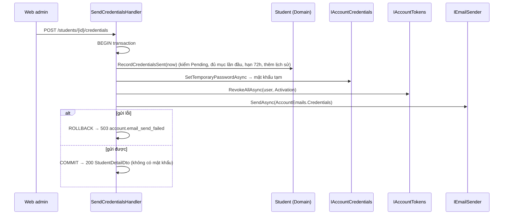

# Technical Design: F01-P1 — Tài khoản học viên (gửi thông tin đăng nhập, kích hoạt, đặt lại mật khẩu)

## Meta

| Field | Value |
|-------|-------|
| Author | Hoangduc1203BK (soạn cùng Claude) |
| Date | 2026-11-25 |
| Spec | `docs/agentic-workflow/specs/2026-11-25-f01-p1-tai-khoan-hoc-vien.md` |
| BDD | `@BR-f01-p1-tai-khoan-hoc-vien-*` trong `features/hoc-vien/tai-khoan/{thong-tin-dang-nhap,kich-hoat,dat-lai-mat-khau}.feature` |
| JIRA | N/A — local-only |

---

## 1. Tổng quan

### Vấn đề
Hồ sơ học viên (F02) tạo tài khoản Identity "Chờ kích hoạt" không mật khẩu. Hiện chưa có cách nào để học viên vào được hệ thống. `IEmailSender` đã có nhưng chưa dùng. Hệ thống cũng chưa có URL public của web học viên, và web học viên chỉ có trang `/login`.

### Goals
- Coach gửi, gửi lại thông tin đăng nhập, sửa email trước kích hoạt và gửi link đặt lại; thấy trạng thái và lịch sử tài khoản (US-01, 02, 05).
- Học viên kích hoạt bằng mật khẩu tạm rồi đặt mật khẩu riêng; tự đặt lại mật khẩu qua Quên mật khẩu (US-03, 04).
- Email thật qua Resend trên staging; e2e đọc được email qua provider `Capture`.

### Non-Goals
Coach quên mật khẩu, đổi mật khẩu khi đang đăng nhập, xác minh domain gửi mail, gửi lại email lỗi tự động (spec §5).

---

## 2. Bối cảnh & Kiến trúc tổng quan

### Hiện trạng
- `AuthService.LoginAsync` (`backend/src/Coaching.Infrastructure/Identity/AuthService.cs`): kiểm khóa theo `IClock` → `CheckPasswordAsync` → kiểm role theo web. Sai ở bước nào cũng trả `AuthErrors.InvalidCredentials` (BR-f00-codebase-006), trừ sai web thì trả `WrongApp`. `RevokeAllAsync` đang là hàm private.
- `Student` (`Coaching.Domain/Students/Student.cs`) có `AccountStatus` nhưng không có hàm nào chuyển sang `Activated`. Lịch sử coaching là entity con chỉ thêm (ADR-f02-ho-so-hoc-vien-005). Đây là mẫu cho lịch sử tài khoản.
- `IStudentAccounts.CreatePendingAsync` tạo user không mật khẩu. Trùng email (kể cả coach) trả `StudentErrors.EmailTaken`.
- `IEmailSender` có hai cài đặt `Log` và `Resend`, chọn bằng `Email:Provider`. Acceptance và integration test đặt `Log`.
- `ErrorKind` hiện có: Validation/Unauthorized/Forbidden/NotFound/Conflict.
- Rate limit `auth` là 10 yêu cầu/phút/IP (`Coaching.Api/Common/RateLimitPolicies.cs`).
- FE: `LoginPageComponent` nằm ở `shared`, dùng cho cả hai app. Web học viên chỉ có `/login` và `/hom-nay`.

### Kiến trúc tổng quan

Thay đổi chạm API, hai web và một dịch vụ ngoài (Resend):

```mermaid
flowchart LR
  Admin[Web admin] -->|/api/admin/students/{id}/credentials, /email, /password-reset-link| API
  Client[Web học viên] -->|/api/auth/login, /activate, /forgot-password, /reset-password| API
  API -->|EF Core| DB[(SQL Server: Students, StudentAccountEvents, AccountTokens, AspNetUsers)]
  API -->|IEmailSender| Resend[Resend API]
  API -.->|Provider=Capture| Mem[(Hộp thư trong bộ nhớ + GET /api/test/emails)]
  E2E[Playwright e2e] -.-> Mem
```

---

## 3. Giải pháp đề xuất

### Quyết định kiến trúc

- `ADR-f01-p1-tai-khoan-hoc-vien-001` — Mật khẩu tạm là mật khẩu Identity của user; hạn dùng và thời điểm gửi lưu trong `Student`.
  - **Lý do:** Identity đã lưu dạng băm (NFR-f01-p1-tai-khoan-hoc-vien-001), đã có khóa đăng nhập và thông báo chung của F00. Gửi lại hoặc kích hoạt chỉ cần đặt mật khẩu mới, mật khẩu cũ tự mất hiệu lực (BR-f01-p1-tai-khoan-hoc-vien-005, BR-f01-p1-tai-khoan-hoc-vien-016).
  - **Trade-off:** `AuthService` phải đọc `Student` để biết mật khẩu đang dùng là mật khẩu tạm và còn hạn hay không.
- `ADR-f01-p1-tai-khoan-hoc-vien-002` — Đăng nhập bằng mật khẩu tạm còn hạn không cấp phiên. API trả `200 { activationRequired: true, activationToken, activationTokenExpiresAt }`.
  - **Lý do:** Không có JWT nên học viên không gọi được API dữ liệu nào (BR-f01-p1-tai-khoan-hoc-vien-011). Mã kích hoạt bị hủy khi coach gửi lại hoặc sửa email, nên trường hợp "đang đặt mật khẩu bằng mật khẩu A" bị chặn (BR-f01-p1-tai-khoan-hoc-vien-005).
  - **Trade-off:** Body của `POST /api/auth/login` có thêm một dạng mới, FE phải phân biệt hai dạng.
  - Khi đăng nhập web quản trị bằng mật khẩu tạm, hệ thống trả `InvalidCredentials`, không trả `WrongApp`. Mật khẩu tạm hết hạn cũng trả `InvalidCredentials` và tính là một lần sai (BR-f01-p1-tai-khoan-hoc-vien-012).
- `ADR-f01-p1-tai-khoan-hoc-vien-003` — Thêm bảng `AccountTokens` dùng chung cho mã kích hoạt và link đặt lại. Bảng chỉ lưu SHA-256 (`TokenHasher`), có hạn dùng, `ConsumedAt` và `RevokedAt`. Tạo token mới thì mọi token cùng mục đích còn hiệu lực của user bị đặt `RevokedAt`.
  - **Lý do:** Token reset có sẵn của Identity không đáp ứng được "có link mới thì link cũ hết hiệu lực" (BR-f01-p1-tai-khoan-hoc-vien-020). Tự quản lý thì đủ cả 30 phút, dùng một lần, và lần nhập sai không làm mất link (BR-f01-p1-tai-khoan-hoc-vien-018, BR-f01-p1-tai-khoan-hoc-vien-019).
  - **Trade-off:** Thêm một bảng và một job dọn dẹp sau này (chưa cần ở quy mô 1 coach).
  - Thời hạn: mã kích hoạt sống 30 phút nhưng không quá hạn mật khẩu tạm; link đặt lại sống đúng 30 phút. Token hết hạn khi `now >= ExpiresAt`.
- `ADR-f01-p1-tai-khoan-hoc-vien-004` — Các thao tác có gửi email (gửi/gửi lại thông tin, sửa email của hồ sơ đã gửi, coach gửi link) chạy trong `IUnitOfWork.ExecuteInTransactionAsync`, gọi `IEmailSender.SendAsync` làm bước cuối trước commit. Gửi lỗi thì rollback và trả `account.email_send_failed` (503).
  - **Lý do:** Đảm bảo "gửi lỗi thì không đổi gì, lịch sử không thêm dòng" (BR-f01-p1-tai-khoan-hoc-vien-006, BR-f01-p1-tai-khoan-hoc-vien-009) mà không cần outbox.
  - **Trade-off:** Transaction giữ trong lúc gọi Resend (~1 s). Nếu email đã đi mà commit lỗi, học viên nhận một mật khẩu không dùng được; coach gửi lại là xong.
- `ADR-f01-p1-tai-khoan-hoc-vien-005` — `POST /api/auth/forgot-password` luôn trả `202` với cùng một body. Email đặt lại được đẩy vào hàng đợi trong process (`Channel<EmailMessage>` + `BackgroundService`). Giới hạn 60 giây dựa trên token `Source = Self` gần nhất của user.
  - **Lý do:** Thời gian phản hồi không phụ thuộc việc có gửi mail hay không (BR-f01-p1-tai-khoan-hoc-vien-023, NFR-f01-p1-tai-khoan-hoc-vien-002). Giới hạn được kiểm theo tài khoản, không theo IP (BR-f01-p1-tai-khoan-hoc-vien-024).
  - **Trade-off:** Mail trong hàng đợi mất khi process khởi động lại; học viên xin lại link.
- `ADR-f01-p1-tai-khoan-hoc-vien-006` — Lịch sử tài khoản là entity con `StudentAccountEvent` của `Student`, chỉ thêm, không có API sửa hay xóa. Có 5 loại: `CredentialsSent`, `CredentialsResent`, `EmailChanged` (kèm email cũ → mới), `ResetLinkSent`, `Activated`.
  - **Lý do:** Cùng mẫu với lịch sử coaching (ADR-f02-ho-so-hoc-vien-005); aggregate tự thêm dòng trong cùng hàm nghiệp vụ (BR-f01-p1-tai-khoan-hoc-vien-027).
  - **Trade-off:** Học viên tự đặt lại mật khẩu không ghi dòng nào, đúng spec. Vết của việc này chỉ nằm trong `AccountTokens`.
- `ADR-f01-p1-tai-khoan-hoc-vien-007` — Thêm provider `Email:Provider=Capture`: lưu thư vào hộp thư trong bộ nhớ, đọc qua `GET /api/test/emails?to=`. Endpoint chỉ được map khi provider là `Capture`, và API dừng khởi động nếu đặt `Capture` ở môi trường `Production`.
  - **Lý do:** e2e (`@web`) đọc được mật khẩu tạm và link đặt lại mà không thêm container hay dependency (PO chọn 2026-11-25).
  - **Trade-off:** Đây là endpoint lộ email, chỉ an toàn nhờ hai chốt cấu hình trên. Có integration test riêng cho hai chốt này.
  - Acceptance dùng `CapturingEmailSender` thay qua DI, có công tắc `FailNext` để mô phỏng dịch vụ email lỗi.
- `ADR-f01-p1-tai-khoan-hoc-vien-008` — Địa chỉ trong email lấy từ cấu hình `App:ClientBaseUrl` (Render: `App__ClientBaseUrl`). Thiếu cấu hình thì trả `account.client_url_missing` (503) và không gửi. Nội dung email nằm trong `AccountEmails` ở Infrastructure, có cả text và HTML.
  - **Lý do:** Đáp ứng NFR-f01-p1-tai-khoan-hoc-vien-003. Nội dung email do dev giữ, coach duyệt trước khi bật Resend (NFR-f01-p1-tai-khoan-hoc-vien-005).
  - **Trade-off:** Muốn đổi câu chữ email phải deploy lại; chấp nhận được ở MVP.
- `ADR-f01-p1-tai-khoan-hoc-vien-009` — Đặt lại mật khẩu thành công thì thu hồi mọi refresh token của user. `RevokeAllAsync` tách thành `ISessionRevoker.RevokeAllAsync(userId, reason)` dùng chung với F00, thêm reason `PasswordReset`.
  - **Lý do:** Đáp ứng BR-f01-p1-tai-khoan-hoc-vien-021. Access token còn sống tối đa 15 phút (F00); lần làm mới kế tiếp bị từ chối, thiết bị khác phải đăng nhập lại.
  - **Trade-off:** Thiết bị khác vẫn đọc được dữ liệu trong tối đa 15 phút sau khi đặt lại; không thêm cơ chế chặn JWT.
- `ADR-f01-p1-tai-khoan-hoc-vien-010` — Route web học viên dùng tiếng Việt: `/kich-hoat`, `/quen-mat-khau`, `/dat-lai-mat-khau`. Link đặt lại có dạng `<ClientBaseUrl>/dat-lai-mat-khau#t=<token>`; mã kích hoạt chỉ giữ trong bộ nhớ của FE.
  - **Lý do:** Thống nhất với ADR-f02-ho-so-hoc-vien-008. Phần sau `#` không lên server và không lọt vào Referer hay log.
  - **Trade-off:** Tải lại trang `/kich-hoat` sẽ mất mã kích hoạt; học viên phải đăng nhập lại bằng mật khẩu tạm.

### Component Design

**Domain** (`Coaching.Domain/Students/`)
- `Student`: thêm `CredentialsSentAt`, `TempPasswordExpiresAt`, `ActivatedAt`, `AccountEvents` (read-only). Các hàm:
  - `RecordCredentialsSent(at)`: kiểm Pending (BR-f01-p1-tai-khoan-hoc-vien-001). Lần đầu thì kiểm `MissingRequiredFields` rỗng (BR-f01-p1-tai-khoan-hoc-vien-002). Đặt hạn `at + 72h` (BR-f01-p1-tai-khoan-hoc-vien-004), thêm `CredentialsSent` hoặc `CredentialsResent`.
  - `ChangeEmail(Email, actor, at)`: kiểm Pending (BR-f01-p1-tai-khoan-hoc-vien-007), thêm `EmailChanged`, cập nhật `SearchKey`. Trả `bool` cho biết hồ sơ đã từng gửi thông tin hay chưa (BR-f01-p1-tai-khoan-hoc-vien-009, BR-f01-p1-tai-khoan-hoc-vien-010).
  - `RecordResetLinkSent(at)`: kiểm Activated (BR-f01-p1-tai-khoan-hoc-vien-017).
  - `Activate(at)`: chuyển Pending → Activated, đặt `ActivatedAt`, thêm `Activated` (BR-f01-p1-tai-khoan-hoc-vien-016).
  - `AccountState(now)`: trả `NotSent | Sent | TempPasswordExpired | Activated` (BR-f01-p1-tai-khoan-hoc-vien-026).
- `StudentAccountEvent : Entity<Guid>`: `Type`, `At`, `ActorUserId?`, `FromEmail?`, `ToEmail?`.
- `PasswordPolicy` (static): độ dài 8–128 không trim, hai lần nhập phải khớp theo so sánh ordinal (BR-f01-p1-tai-khoan-hoc-vien-013, BR-f01-p1-tai-khoan-hoc-vien-014, BR-f01-p1-tai-khoan-hoc-vien-015).

**Application**
- Port `IAccountCredentials` (cài đặt ở Infrastructure bằng `UserManager`):
  - `SetTemporaryPasswordAsync(userId) → string`: sinh 12 ký tự từ bảng chữ không dễ nhầm, gọi `RemovePassword`/`AddPassword`.
  - `SetOwnPasswordAsync(userId, password)`
  - `ChangeEmailAsync(userId, Email) → Result` (trùng → `StudentErrors.EmailTaken`)
  - `FindStudentUserByEmailAsync(email) → Guid?`
- Port `IAccountTokens`: `IssueAsync(userId, purpose, source, expiresAt) → string`, `RedeemAsync(raw, purpose) → Guid? userId`, `RevokeAllAsync(userId, purpose)`, `LastIssuedAtAsync(userId, purpose, source)`.
- Port `IAccountEmailComposer` gồm `Credentials(...)` và `ResetLink(...)` → `Result<EmailMessage>`. Trả `ClientUrlMissing` khi thiếu cấu hình.
- Port `ISessionRevoker`, theo ADR-f01-p1-tai-khoan-hoc-vien-009.
- Handlers trong `Students/Commands/`: `SendCredentialsHandler`, `ChangeStudentEmailHandler`, `SendPasswordResetLinkHandler`.
- Handlers trong `Accounts/Commands/`: `ActivateAccountHandler`, `RequestPasswordResetHandler`, `ResetPasswordHandler`.
- `AuthService.LoginAsync` sửa theo ADR-f01-p1-tai-khoan-hoc-vien-002. Đọc `Students` theo `UserId` khi role là Student và `AccountStatus = PendingActivation`.
- `StudentDetailDto` thêm `Account: AccountInfoDto(State, CredentialsSentAt, TempPasswordExpiresAt, ActivatedAt, History[])`. `History` xếp mới nhất trước và không có trường bí mật nào (BR-f01-p1-tai-khoan-hoc-vien-025).
- `ErrorKind.Unavailable`, map sang 503 trong `ResultExtensions`.

**Infrastructure**
- `AccountTokens` (entity + config) và `AccountTokenStore : IAccountTokens`.
- `AccountCredentials : IAccountCredentials`.
- `AccountEmails : IAccountEmailComposer`, `AppOptions { ClientBaseUrl }`.
- `CapturingEmailSender` + `EmailOutbox` (singleton), `QueuedEmailSender` + `EmailQueueWorker`.

**Api**
- `AuthController`: thêm `activate`, `forgot-password`, `reset-password` (policy rate limit `auth`).
- `StudentsController`: thêm 3 route (xem API Contracts).
- `TestEmailsController`: chỉ map khi provider là `Capture`.

### API Contracts

| Method + route | Body | Thành công | Lỗi (code → status) |
|---|---|---|---|
| `POST /api/auth/login` | như F00 | `200 AuthTokens` hoặc `200 { activationRequired: true, activationToken, activationTokenExpiresAt }` | `auth.invalid_credentials` 401 |
| `POST /api/auth/activate` | `{ activationToken, password, confirmPassword }` | `200 AuthTokens` (vào thẳng) | `auth.activation_invalid` 401 "Phiên kích hoạt đã hết hạn. Vui lòng đăng nhập lại bằng mật khẩu tạm mới nhất."; `auth.password_too_short` 400 "Mật khẩu cần ít nhất 8 ký tự."; `auth.password_too_long` 400 "Mật khẩu tối đa 128 ký tự."; `auth.password_mismatch` 400 "Hai lần nhập mật khẩu không khớp." |
| `POST /api/auth/forgot-password` | `{ email }` | luôn `202 { message: "Nếu email này thuộc tài khoản học viên đã kích hoạt, link đặt lại mật khẩu đã được gửi tới email đó. Link có hiệu lực trong 30 phút. Không thấy email thì kiểm tra mục Spam." }` | — (chỉ 429 của rate limit IP) |
| `POST /api/auth/reset-password` | `{ token, password, confirmPassword }` | `204` | `auth.reset_link_invalid` 400 "Link đặt lại đã hết hạn hoặc đã được dùng. Hãy xin link mới."; 3 lỗi mật khẩu như trên |
| `POST /api/admin/students/{id}/credentials` | `{}` | `200 StudentDetailDto` | `account.already_activated` 409 "Tài khoản đã kích hoạt. Chỉ gửi được link đặt lại mật khẩu."; `account.required_fields_missing` 400 "Còn {n} mục bắt buộc chưa điền."; `account.email_send_failed` 503 "Chưa gửi được email. Vui lòng thử lại sau."; `account.client_url_missing` 503; `student.not_found` 404 |
| `PUT /api/admin/students/{id}/email` | `{ email, version }` | `200 StudentDetailDto` | `account.email_locked` 409 "Tài khoản đã kích hoạt, không sửa được email."; `student.email_taken` 409; Email không hợp lệ 400 (F02); `student.version_conflict` 409; `account.email_send_failed` 503 |
| `POST /api/admin/students/{id}/password-reset-link` | `{}` | `200 StudentDetailDto` | `account.not_activated` 409 "Tài khoản chưa kích hoạt. Hãy gửi thông tin đăng nhập."; `account.email_send_failed` 503 |
| `GET /api/test/emails?to=` | — | `200 [{ to, subject, textBody, sentAt }]` | chỉ tồn tại khi `Email:Provider=Capture` |

### Data Model / Database Changes
Liquibase `database/changelog/v0.3.0/` (xml + `scripts/*.sql` + `rollback/*.sql`):
- `Students` thêm `CredentialsSentAt datetimeoffset NULL`, `TempPasswordExpiresAt datetimeoffset NULL`, `ActivatedAt datetimeoffset NULL`.
- `StudentAccountEvents`:
  - Cột: `Id uniqueidentifier PK`, `StudentId FK → Students`, `Type nvarchar(30)`, `At datetimeoffset`, `ActorUserId uniqueidentifier NULL`, `FromEmail nvarchar(256) NULL`, `ToEmail nvarchar(256) NULL`.
  - Index `(StudentId, At)`.
- `AccountTokens`:
  - Cột: `Id uniqueidentifier PK`, `UserId FK → AspNetUsers`, `Purpose nvarchar(20)` (`Activation`/`PasswordReset`), `Source nvarchar(10)` (`Coach`/`Self`/`Login`), `TokenHash nvarchar(64) UNIQUE`, `CreatedAt`, `ExpiresAt`, `ConsumedAt NULL`, `RevokedAt NULL`.
  - Index `(UserId, Purpose)`.
- Rollback xóa 2 bảng và 3 cột.

### Data Flow — gửi thông tin đăng nhập (gửi lại, và sửa email của hồ sơ đã gửi, đi cùng đường)



Kích hoạt: `login` (mật khẩu tạm còn hạn) → phát `Activation` token → `activate` → `RedeemAsync` → kiểm `PasswordPolicy` (lỗi không tiêu token) → `SetOwnPasswordAsync` + `Student.Activate` + tiêu token trong một transaction → cấp `AuthTokens`.

### Thiết kế giao diện (UI)

- **Design link**: `docs/duobexiuuu-coaching-design.html`, các page `Main`, `AdTaoHoSo`, `AdHoSo` (không có Figma/Code Connect). Token, font, breakpoint 880 px theo CLAUDE.md; kiểm ở 390 px và 1280 px.
- **Web học viên** (page `Main`; trang `/login` hiện có giữ nguyên bố cục cover + form):
  - **Đăng nhập** — `/login`: thêm nút "Quên mật khẩu?" cạnh nhãn Mật khẩu và đoạn "Lần đầu vào? …" như prototype. Đăng nhập nhận `activationRequired` thì chuyển sang `/kich-hoat`. Nút "Quên mật khẩu?" chỉ hiện ở web học viên.
  - **Kích hoạt** — `/kich-hoat` (state `isActivate`):
    - Bố cục: tiêu đề phụ "Bước cuối để kích hoạt tài khoản", H1 "Đặt mật khẩu riêng", hai ô "Mật khẩu mới" và "Nhập lại mật khẩu", checklist "Ít nhất 8 ký tự" / "Hai lần nhập trùng nhau" (tick `--ok` khi đạt), nút "Lưu mật khẩu và vào trang Hôm nay".
    - Thành công → `/hom-nay`.
    - Vào trang mà không có mã kích hoạt → về `/login`.
    - Lỗi `auth.activation_invalid` → về `/login` kèm thông báo lỗi.
  - **Quên mật khẩu** — `/quen-mat-khau` (state `isForgot`): H1 "Quên mật khẩu", ô Email, nút "Gửi link đặt lại", hộp `role=status` (nền `--okBg`) hiện câu chung ở bảng API, nút "Quay lại đăng nhập".
  - **Đặt lại mật khẩu** — `/dat-lai-mat-khau#t=…`. *Suy ra*: prototype không có màn này nên dùng lại bố cục Kích hoạt.
    - Nội dung: H1 "Đặt lại mật khẩu", mô tả "Link có hiệu lực 30 phút và chỉ dùng được một lần.", cùng hai ô và checklist, nút "Lưu mật khẩu mới".
    - Thành công → `/login` với hộp `--okBg` "Đã đặt lại mật khẩu. Đăng nhập bằng mật khẩu mới."
    - Link hỏng → hộp `--warnBg` với câu lỗi của API và nút "Xin link mới" (mở `/quen-mat-khau`).
- **Web admin**:
  - **Tạo hồ sơ** (`AdTaoHoSo`, `/hoc-vien/moi`):
    - Nút chính "Lưu và gửi thông tin đăng nhập": gọi `POST /students`, rồi `POST /students/{id}/credentials`.
    - Nút "Chỉ lưu hồ sơ" (đổi lại theo prototype).
    - Thông báo dùng đúng câu prototype: "Đã lưu hồ sơ và gửi thông tin đăng nhập." hoặc "Còn {n} mục bắt buộc chưa điền. Các ô thiếu đã được đánh dấu đỏ." Nếu gửi lỗi sau khi đã lưu: "Đã lưu hồ sơ nhưng chưa gửi được thông tin đăng nhập. Vui lòng thử lại." rồi chuyển sang trang hồ sơ.
    - Aside "Trạng thái tài khoản": `stText`/`stNote` như prototype. Card "Học viên sẽ nhận gì" như prototype.
  - **Hồ sơ** (`AdHoSo`, `/hoc-vien/:id`):
    - Header: sau chip coaching hiện "Kích hoạt dd/MM/yyyy" (13px, `--muted`) khi đã kích hoạt.
    - Nút phụ (44 px, viền `--field`) theo trạng thái tài khoản: "Gửi thông tin đăng nhập" (chưa gửi), "Gửi lại thông tin đăng nhập" (đã gửi / hết hạn), "Gửi link đặt lại mật khẩu" (đã kích hoạt).
    - Card **"Tài khoản đăng nhập"** ở cột phải, đúng kiểu `isTaiKhoan` của prototype. Dòng trạng thái như BR-f01-p1-tai-khoan-hoc-vien-026, ví dụ "Đã gửi lúc 01/11 09:00. Mật khẩu tạm hết hạn 04/11 09:00." Danh sách lịch sử `<ol>` có viền trái `--soft`, mỗi dòng "**dd/MM HH:mm** {câu}".
    - Câu của từng loại sự kiện:
      - "Gửi thông tin đăng nhập lần đầu."
      - "Gửi lại thông tin đăng nhập. Mật khẩu tạm cũ bị huỷ."
      - "Sửa email từ {cũ} sang {mới}."
      - "Gửi link đặt lại mật khẩu."
      - "Học viên đặt mật khẩu riêng. Tài khoản Đã kích hoạt."
    - Ghi chú cuối card: "Mật khẩu riêng do học viên quản lý. Coach chỉ gửi được link đặt lại mật khẩu qua email."
  - **Sửa hồ sơ** (`/hoc-vien/:id/sua`): ô Email cho sửa khi tài khoản Chờ kích hoạt; khi đã kích hoạt thì chỉ xem như F02.
    - Đổi email thì lưu qua `PUT /email` trước, sau đó `PUT` hồ sơ.
    - Nếu hồ sơ đã gửi thông tin, hiện ghi chú dưới ô: "Đổi email sẽ huỷ mật khẩu tạm cũ và gửi thông tin đăng nhập mới tới email mới."

### Nội dung email (bản nháp, coach duyệt trước khi bật Resend — NFR-f01-p1-tai-khoan-hoc-vien-005)
- **Thông tin đăng nhập** — tiêu đề "Thông tin đăng nhập Duobexiuuu Coaching". Thân thư:
  - Lời chào theo họ tên.
  - Địa chỉ đăng nhập `<ClientBaseUrl>/login`.
  - Email tài khoản và mật khẩu tạm.
  - "Mật khẩu tạm có hiệu lực 72 giờ. Lần đầu đăng nhập, bạn sẽ đặt mật khẩu riêng."
  - Chữ ký Coach Duobexiuuu.
- **Đặt lại mật khẩu** — tiêu đề "Đặt lại mật khẩu Duobexiuuu Coaching". Thân thư:
  - Link `<ClientBaseUrl>/dat-lai-mat-khau#t=…`.
  - "Link có hiệu lực 30 phút và chỉ dùng được một lần. Nếu bạn không yêu cầu, hãy bỏ qua email này."

---

## 4. Các phương án đã cân nhắc

- **Lưu mật khẩu tạm riêng, ngoài Identity** — loại: phải tự băm, tự đếm lần sai và tự khóa, trùng với F00.
- **Đăng nhập bằng mật khẩu tạm cấp JWT có claim "must-set-password" và lọc ở middleware** — loại: mọi endpoint phải nhớ chặn. Nếu sót một chỗ, học viên xem được dữ liệu trước khi kích hoạt (BR-f01-p1-tai-khoan-hoc-vien-011).
- **Mailpit + SMTP cho e2e** — loại theo PO 2026-11-25: thêm container và dependency MailKit.
- **Outbox cho email** — loại: chỉ cần thiết khi email phải gửi chắc chắn sau commit. Ở đây thứ tự ngược lại (gửi lỗi thì không commit) mới đúng với BR-f01-p1-tai-khoan-hoc-vien-006.

---

## 5. Implementation Map

| # | File (C = tạo, M = sửa) | Nội dung | BR / ADR |
|---|---|---|---|
| 1 | C `database/changelog/v0.3.0/**`; M `database/changelog/db.changelog-master.xml` | 3 cột `Students`, bảng `StudentAccountEvents`, `AccountTokens` | ADR-f01-p1-tai-khoan-hoc-vien-003, 006 |
| 2 | M `Coaching.Domain/Students/Student.cs`; C `StudentAccountEvent.cs`, `AccountEventType.cs`, `AccountState.cs`, `PasswordPolicy.cs`; test `Coaching.Domain.Tests/Students/**` | Quy tắc tài khoản trong aggregate | BR-f01-p1-tai-khoan-hoc-vien-001, 002, 004, 007, 010, 013, 014, 015, 016, 026, 027; ADR-f01-p1-tai-khoan-hoc-vien-006 |
| 3 | C `Coaching.Infrastructure/Emailing/{CapturingEmailSender,EmailOutbox,QueuedEmailSender,EmailQueueWorker,AccountEmails,AppOptions}.cs`; M `DependencyInjection.cs`, `EmailOptions.cs`; C `Coaching.Api/Controllers/TestEmailsController.cs`; M `Program.cs` | Provider Capture, hàng đợi, nội dung email, chốt Production | ADR-f01-p1-tai-khoan-hoc-vien-005, 007, 008; NFR-f01-p1-tai-khoan-hoc-vien-003 |
| 4 | C `Coaching.Infrastructure/Identity/{AccountTokenStore,AccountToken,AccountCredentials,SessionRevoker}.cs`, `Persistence/Configurations/{AccountTokenConfiguration,StudentAccountEventConfiguration}.cs`; M `Seeding/DatabaseInitializer.cs` (demo Pending → Activate), `Emailing/LoggingEmailSender.cs` (Production không ghi thân thư), `StudentConfiguration.cs`, `AppDbContext.cs`, `AuthService.cs`, `RefreshTokenRevokedReason.cs` | Token, mật khẩu, thu hồi phiên | ADR-f01-p1-tai-khoan-hoc-vien-001, 003, 009; NFR-f01-p1-tai-khoan-hoc-vien-001 |
| 5 | C `Coaching.Application/Students/Commands/{SendCredentials,ChangeStudentEmail,SendPasswordResetLink}.cs`; M `StudentDtos.cs`, `StudentErrors.cs`, `Common/Result.cs`; M `Coaching.Api/Controllers/Admin/StudentsController.cs`, `Common/ResultExtensions.cs` | API coach | BR-f01-p1-tai-khoan-hoc-vien-003, 005, 006, 008, 009, 017, 025; ADR-f01-p1-tai-khoan-hoc-vien-004 |
| 6 | C `Coaching.Application/Accounts/**`; M `Coaching.Application/Auth/{AuthErrors,AuthModels}.cs`, `AuthService.cs`, `Coaching.Api/Controllers/AuthController.cs` | Đăng nhập bằng mật khẩu tạm, kích hoạt, quên/đặt lại | BR-f01-p1-tai-khoan-hoc-vien-011, 012, 018, 019, 020, 021, 022, 023, 024; ADR-f01-p1-tai-khoan-hoc-vien-002; NFR-f01-p1-tai-khoan-hoc-vien-002 |
| 7 | M `backend/tests/Coaching.Acceptance/**` (steps + `AcceptanceContext` dùng `CapturingEmailSender`), `Coaching.Api.IntegrationTests/**` | Bind 54 scenario + test LOẠI/NFR | — |
| 8 | M `frontend/projects/shared/src/lib/{auth,login}/**`; C `frontend/projects/client/src/app/account/{activate,forgot-password,reset-password}.component.ts`; M `client/src/app/app.routes.ts` | 3 màn web học viên + login | ADR-f01-p1-tai-khoan-hoc-vien-010 |
| 9 | M `frontend/projects/admin/src/app/students/{student-form,student-profile,students.api,student.models}.ts`; C `account-card.component.ts` | Nút gửi, card tài khoản, sửa email | BR-f01-p1-tai-khoan-hoc-vien-026 (UI) |
| 10 | C `frontend/e2e/steps/account.steps.ts`; M `frontend/e2e/support/**`, `deploy/docker-compose.yml` (`Email__Provider: Capture`, `App__ClientBaseUrl`), `deploy/.env.example`, `.github/workflows/*.yml`, `CLAUDE.md` (route web học viên) | e2e `@web` + cấu hình | ADR-f01-p1-tai-khoan-hoc-vien-007 |

Thứ tự: 1 → 2 → 3, 4 → 5, 6 → 7 → 8, 9 → 10.

---

## 6. Test Strategy

### Acceptance / E2E
- Scenario `@BR-f01-p1-tai-khoan-hoc-vien-*` trong `features/hoc-vien/tai-khoan/*.feature`:
  - `@api` chạy bằng Reqnroll, dùng `FakeTimeProvider` cho 72 giờ, 30 phút, 60 giây và `CapturingEmailSender.FailNext` cho email lỗi.
  - `@web` chạy CucumberJS + Playwright trên compose, đọc thư qua `GET /api/test/emails`.
- Living doc F02 (`ho-so-hoc-vien.feature`) giữ nguyên scenario, chỉ đổi câu của rule BR-f02-ho-so-hoc-vien-012.

### Unit / Integration
| Kiểm | Ở đâu |
|---|---|
| Seed LOẠI: học viên tự xin Quên mật khẩu → lịch sử không thêm dòng (BR-f01-p1-tai-khoan-hoc-vien-027) | Integration |
| BR-f01-p1-tai-khoan-hoc-vien-025: không DTO admin/client nào có trường mật khẩu/token | Test kiến trúc quét DTO + integration so body với mật khẩu trong thư capture |
| NFR-f01-p1-tai-khoan-hoc-vien-001: DB chỉ có hash; ở Production `LoggingEmailSender` chỉ ghi người nhận + tiêu đề, không ghi thân thư | Integration đọc bảng + unit test `LoggingEmailSender` theo môi trường |
| NFR-f01-p1-tai-khoan-hoc-vien-002: 4 loại email trả cùng status + body | Integration (thời gian: đo thủ công, xem Manual) |
| NFR-f01-p1-tai-khoan-hoc-vien-003: thiếu `App:ClientBaseUrl` → 503, không có thư | Integration |
| ADR-f01-p1-tai-khoan-hoc-vien-007: `Capture` ở Production → không khởi động; provider khác → `/api/test/emails` 404 | Integration |
| `PasswordPolicy`, `Student` chuyển trạng thái, `AccountState` theo giờ | Domain test |
| `AccountTokenStore`: hết hạn đúng mốc, tiêu một lần, token mới hủy token cũ | Integration |
| FE: checklist mật khẩu, không trim, đọc token từ fragment, hai dạng response login | Spec Angular |

### Automated verification
```bash
dotnet test backend/Coaching.slnx --filter "Category!=web&Category!=manual"
cd frontend && npm run test:ci && npx ng build admin && npx ng build client && npm run e2e
```

### Manual verification
- So 4 màn web học viên + 3 màn admin với prototype ở 390 px và 1280 px.
- NFR-f01-p1-tai-khoan-hoc-vien-002: đo `forgot-password` 20 lần mỗi loại email, chênh lệch trung vị < 20 ms.
- NFR-f01-p1-tai-khoan-hoc-vien-004: đo p95 các endpoint mới (Provider `Capture`) < 500 ms.
- NFR-f01-p1-tai-khoan-hoc-vien-005: coach đọc 2 email mẫu trên staging (Resend gửi tới email chủ tài khoản) và duyệt.

---

## 7. Risks & Mitigations

| Risk | Khả năng | Ảnh hưởng | Giảm thiểu |
|---|---|---|---|
| Resend chưa xác minh domain → chỉ gửi được tới email chủ tài khoản | Cao | Trung bình (staging) / Cao (thật) | Staging dùng `onboarding@resend.dev` và thử bằng email của PO; xác minh domain trước khi coach dùng thật (OQ-01) |
| Email đi rồi mà commit lỗi → mật khẩu trong thư không dùng được | Thấp | Thấp | Coach gửi lại; lịch sử không ghi lần lỗi |
| Endpoint `/api/test/emails` bật nhầm trên môi trường thật | Thấp | Cao | Hai chốt ADR-f01-p1-tai-khoan-hoc-vien-007 + integration test; Render đặt `Email__Provider=Resend` |
| Đổi body `login` làm hỏng web admin | Thấp | Trung bình | Web admin không bao giờ nhận `activationRequired` (mật khẩu tạm trên web admin trả 401); spec FE cho cả hai dạng |
| Học viên demo F00 đã có mật khẩu nhưng `AccountStatus` vẫn Pending | Cao | Trung bình | Seed demo gọi `Student.Activate` nếu demo còn Pending (idempotent) |

---

## 8. Cross-Cutting Concerns

### Security
- Chỉ `AdminOnly` gọi được 3 route admin, lọc theo `CoachId` như F02.
- Mật khẩu tạm và token chỉ có trong email, không có trong response hay log ở Production.
- `activate` và `reset-password` không yêu cầu JWT; quyền đến từ token đã băm.
- Tất cả route `/api/auth/*` mới dùng rate limit `auth` (10/phút/IP).

### Performance
Mỗi thao tác chỉ đụng vài dòng theo khóa chính hoặc index. Thời gian gửi email không tính vào NFR-f01-p1-tai-khoan-hoc-vien-004.

### Monitoring & Observability
Log `Information` có loại sự kiện và `StudentId`, không có mật khẩu hay token. Lỗi Resend log ở mức `Warning`, kèm status code.

### Backward Compatibility
- `POST /api/auth/login` có thêm một dạng body; dạng cũ giữ nguyên.
- `StudentDetailDto` thêm `account`, không bỏ trường nào.
- `UpdateStudentCommand` vẫn không có email; email đi route riêng.

### Migration & Rollout
- Liquibase `v0.3.0` chạy qua job `db-migrate` khi merge `main`.
- PO cấu hình trên Render (API) trước khi dùng:
  - `App__ClientBaseUrl` = URL static site client.
  - `Email__Provider=Resend`, `Email__From=Duobexiuuu Coaching <onboarding@resend.dev>`, `Email__ResendApiKey`.
- Thiếu `App__ClientBaseUrl` thì API vẫn chạy, nhưng mọi lần gửi trả 503 (NFR-f01-p1-tai-khoan-hoc-vien-003).
- Compose local và e2e dùng `Email__Provider=Capture` và `App__ClientBaseUrl=http://localhost:4300`.

---

## 9. Open Questions

| # | Câu hỏi | Chặn? | Owner | Trạng thái |
|---|---|---|---|---|
| OQ-01 | Domain gửi mail cho môi trường thật | ❌ | PO | Staging dùng `onboarding@resend.dev` (PO chốt 2026-11-25); xác minh domain trước khi coach dùng thật |
| OQ-02 | Câu chữ 2 email (bản nháp ở §3) | ❌ | Coach | Duyệt trên staging trước khi mời học viên thật |
